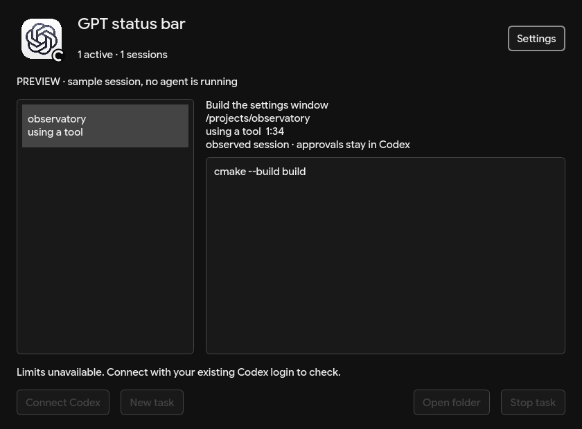
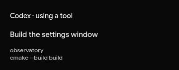
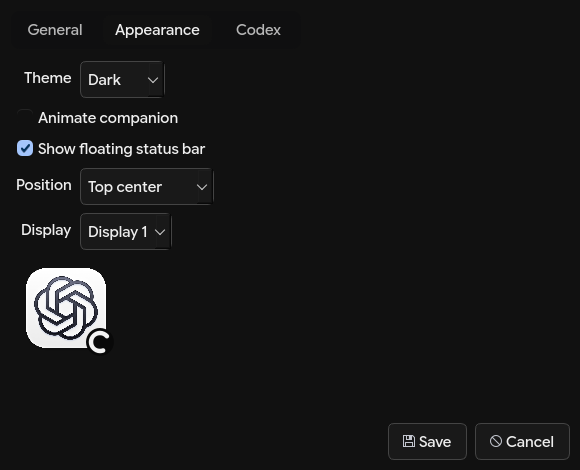

<div align="center">


# GPT status bar

[English](README.md) · [Русский](README.ru.md)

a desktop status companion for OpenAI Codex. see when your agent is working, waiting or done.

[](https://github.com/sorried/chatgpt-status-bar/actions/workflows/build.yml)
[](LICENSE)


</div>

## what it does

- shows a floating status panel and a system tray icon. click either to open session details.
- observes recent Codex sessions automatically, including terminal and desktop sessions that write local rollout files.
- shows the project, latest activity, elapsed turn time, model and reported token totals. waiting and active sessions take priority in the panel.
- connects to `codex app-server` using your existing Codex login. launch a task in a project, allow or deny individual actions, answer questions and stop a task.
- reads account limits through Codex when connected. missing limits remain unavailable instead of being shown as zero.
- includes English and Russian, system/dark/light themes, the ChatGPT logo with a separate activity indicator, reduced motion, display and position choices, notifications, optional sound and start at login.

written in C++17 with Qt 6 Widgets. native desktop executables for Linux, Windows and macOS, without Electron or a webview. the floating panel works on screens with or without a hardware notch.



## get a build

open [desktop builds](https://github.com/sorried/chatgpt-status-bar/actions/workflows/build.yml), select a successful run and download its artifact. GitHub requires signing in to download workflow artifacts. unpack the whole archive so the Qt libraries stay beside the application.

| build | launch |
| --- | --- |
| Linux x64 | `bin/gpt-status-bar` inside the extracted folder |
| Windows x64 | `bin/gpt-status-bar.exe` inside the extracted folder |
| macOS universal, Apple Silicon + Intel | open `gpt-status-bar.app` |

the workflow builds with Qt 6.8.3. the source requires Qt 6.5 or newer. desktop builds are unsigned. macOS may require approval in system settings under privacy and security. on Linux, a tray implementation is needed for the tray icon; the floating panel stays available without one.

## connect Codex

1. install [Codex](https://developers.openai.com/codex/cli/) separately and sign in with `codex login`.
2. open GPT status bar. recent sessions under `$CODEX_HOME/sessions`, or `~/.codex/sessions`, appear automatically.
3. open **settings → Codex** if you use a different home or executable. desktop launchers may have a different `PATH` from your terminal, so an absolute path to the Codex executable can help.
4. choose **connect Codex** to read limits and enable **new task**. select a project folder and enter the task. an empty model field uses your Codex configuration.

observed sessions keep their approval prompts in their original Codex client. tasks launched here can be approved here. new tasks request the `untrusted` approval policy and `workspace-write` isolation. local Codex policy can impose additional restrictions. the app never automatically approves requests or enables unrestricted execution.

closing the monitor leaves it running in the tray and floating panel. use **quit** in the tray menu to exit. quitting stops this application's Codex server; finish or stop its running tasks first. start at login refers to this application's current path, so turn it off before moving or removing the app.

## appearance and settings

the compact black panel shows the ChatGPT logo, current status and elapsed time. hover to reveal the task, project and latest activity. click to open the full monitor. the logo stays unchanged; a separate indicator shows activity. animation can be switched off.




settings are saved through the operating system's Qt settings backend. the app does not store credentials or edit your Codex configuration. Codex handles its own authentication and network requests. observation reads session metadata and recent activity into memory; it does not upload session files or maintain a second transcript archive. notifications contain the project folder name and status, not task text.

## build from source

install a C++17 compiler, CMake 3.21+ and Qt 6.5+ with Widgets and Test. the [Qt installer](https://www.qt.io/download-qt-installer-oss) provides supported desktop packages. on Linux, distribution Qt development packages also work.

```sh
git clone https://github.com/sorried/chatgpt-status-bar.git
cd chatgpt-status-bar
cmake -S . -B build -DCMAKE_BUILD_TYPE=Release
cmake --build build --config Release --parallel
ctest --test-dir build -C Release --output-on-failure
```

if CMake cannot find Qt, pass `-DCMAKE_PREFIX_PATH=/path/to/Qt/6.x/platform`. launch `build/gpt-status-bar` on Linux, `build/Release/gpt-status-bar.exe` with Visual Studio, or `build/gpt-status-bar.app` on macOS. to package Qt dependencies, configure with `-DDEPLOY_QT=ON`, build, then run `cmake --install build --config Release --prefix /absolute/path/to/stage`.

GitHub Actions performs compilation, core tests, a headless startup check and runtime packaging for each desktop platform. a `v*` tag also publishes an experimental prerelease after all builds pass.

```sh
./build/gpt-status-bar --preview
./build/gpt-status-bar --capture work/screenshots --language ru
```

preview uses an isolated settings directory and synthetic data. it does not launch an agent. tests use a fake Codex server and do not send model requests.

## limits and troubleshooting

- local rollout JSONL is an internal Codex format and can change. the monitor reads at most the 64 most recently modified files from the last seven days and starts with the last 512 KiB of each file. older task context may be absent.
- after five minutes without an event, an observed running session is marked **no recent events**. a long silent command may still be running. this is not a completion signal.
- log observation does not detect every permission wait. direct approval control requires a task launched through this application's server connection. unsupported server requests receive an explicit error.
- account limits depend on your Codex login and server support. refresh errors are shown in the connection status.
- on Wayland, window placement and always-on-top behavior depend on the compositor. this application uses a floating panel, not a hardware notch extension.
- this monitors Codex, not browser ChatGPT conversations. it does not include ClaudeNotch's Telegram service, updater or terminal-tab automation.

see [protocol and architecture notes](docs/architecture.md), [third-party notices](docs/third-party.md) and [issues](https://github.com/sorried/chatgpt-status-bar/issues).

## credits and license

the idea was inspired by [ClaudeNotch](https://github.com/CraftStick/ClaudeNotch). this is an independent implementation, not a fork. no source code or character assets from that project are included. its license restricts modifications and derivative works.

this project's code uses the [MIT license](LICENSE). the ChatGPT logo belongs to OpenAI and is excluded from that license. Qt has separate license terms. GPT status bar is not affiliated with OpenAI or Anthropic.

---

this project is vibe-coded and may be unstable. expect bugs and check important actions in Codex.
