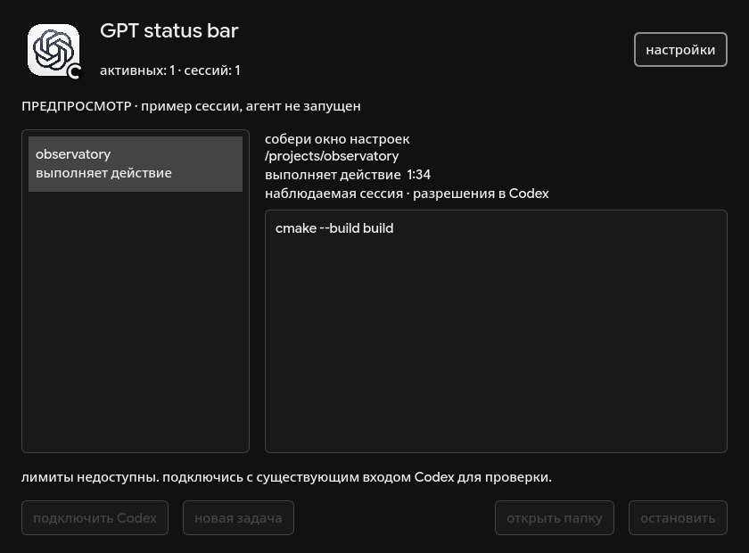
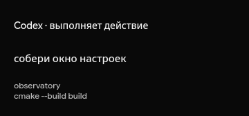
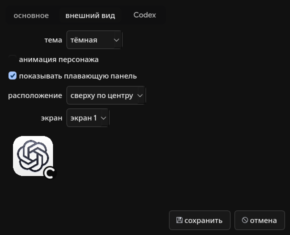

<div align="center">


# GPT status bar

[English](README.md) · [Русский](README.ru.md)

настольный компаньон для OpenAI Codex. показывает, когда агент работает, ждёт ответа или закончил задачу.

[](https://github.com/sorried/chatgpt-status-bar/actions/workflows/build.yml)
[](LICENSE)


</div>

## что умеет

- показывает плавающую панель и значок в трее. нажатие открывает подробности сессий.
- автоматически наблюдает за свежими сессиями Codex, включая терминал и настольный клиент, если они записывают локальные журналы.
- показывает проект, последнее действие, время работы, модель и доступные счётчики токенов. панель отдаёт приоритет ожиданию ответа и работающим задачам.
- подключается к `codex app-server` с существующим входом Codex. можно запустить задачу в проекте, разрешить или отклонить отдельное действие, ответить на вопросы и остановить задачу.
- получает лимиты аккаунта через Codex при подключении. если данных нет, они показаны как недоступные, а не как ноль.
- есть русский и английский языки, системная, тёмная и светлая темы, логотип ChatGPT с отдельным индикатором работы, отключение анимации, выбор экрана и положения, уведомления, необязательный звук и автозапуск.

C++17 и Qt 6 Widgets. нативные настольные приложения для Linux, Windows и macOS без Electron и webview. плавающая панель работает на экранах с вырезом и без него.



## скачать сборку

открой [desktop builds](https://github.com/sorried/chatgpt-status-bar/actions/workflows/build.yml), выбери успешный запуск и скачай артефакт. для скачивания артефактов нужен вход в GitHub. распакуй архив целиком, чтобы библиотеки Qt остались рядом с приложением.

| сборка | запуск |
| --- | --- |
| Linux x64 | `bin/gpt-status-bar` в распакованной папке |
| Windows x64 | `bin/gpt-status-bar.exe` в распакованной папке |
| macOS universal, Apple Silicon и Intel | открой `gpt-status-bar.app` |

в workflow используется Qt 6.8.3. для исходников нужен Qt 6.5 или новее. сборки не подписаны. macOS может потребовать разрешить открытие в настройках системы, в разделе конфиденциальности и безопасности. в Linux значок требует поддержки трея окружением рабочего стола; плавающая панель доступна и без трея.

## подключить Codex

1. отдельно установи [Codex](https://developers.openai.com/codex/cli/) и выполни `codex login`.
2. открой GPT status bar. свежие сессии из `$CODEX_HOME/sessions` или `~/.codex/sessions` появятся автоматически.
3. открой **настройки → Codex**, если используешь другую папку или исполняемый файл. у графического запуска может быть другой `PATH`, чем у терминала, поэтому иногда нужен полный путь к Codex.
4. нажми **подключить Codex**, чтобы получить лимиты и включить **новая задача**. выбери папку проекта и введи задачу. пустое поле модели использует настройки Codex.

у наблюдаемых сессий запросы разрешений остаются в исходном клиенте Codex. задачами, запущенными здесь, можно управлять здесь. для новых задач запрашиваются политика `untrusted` и изоляция `workspace-write`. локальная политика Codex может вводить дополнительные ограничения. приложение не подтверждает запросы автоматически и не включает неограниченное выполнение.

закрытие окна оставляет приложение в трее и на плавающей панели. для выхода выбери **выйти** в меню трея. выход останавливает собственный сервер Codex приложения; сначала заверши или останови его задачи. автозапуск привязан к текущему пути приложения, поэтому отключи его перед переносом или удалением.

## внешний вид и настройки

компактная чёрная панель показывает логотип ChatGPT, состояние и время работы. при наведении открываются задача, проект и последнее действие. нажатие открывает полный монитор. сам логотип не меняется, активность показывает отдельный индикатор. анимацию можно отключить.




настройки сохраняются через системное хранилище Qt. приложение не хранит учётные данные и не меняет конфигурацию Codex. авторизацией и сетевыми запросами занимается Codex. наблюдение читает метаданные и свежие события в память; журналы не загружаются на сервер и не копируются в отдельный архив. уведомления содержат имя папки проекта и состояние, без текста задачи.

## собрать из исходников

нужны компилятор C++17, CMake 3.21+ и Qt 6.5+ с Widgets и Test. готовые пакеты есть в [установщике Qt](https://www.qt.io/download-qt-installer-oss). в Linux подходят и пакеты разработки Qt из дистрибутива.

```sh
git clone https://github.com/sorried/chatgpt-status-bar.git
cd chatgpt-status-bar
cmake -S . -B build -DCMAKE_BUILD_TYPE=Release
cmake --build build --config Release --parallel
ctest --test-dir build -C Release --output-on-failure
```

если CMake не находит Qt, добавь `-DCMAKE_PREFIX_PATH=/path/to/Qt/6.x/platform`. запуск: `build/gpt-status-bar` в Linux, `build/Release/gpt-status-bar.exe` при сборке Visual Studio, `build/gpt-status-bar.app` в macOS. для упаковки зависимостей Qt настрой сборку с `-DDEPLOY_QT=ON`, собери и выполни `cmake --install build --config Release --prefix /absolute/path/to/stage`.

GitHub Actions компилирует приложение, запускает тесты ядра, проверку старта без экрана и упаковывает зависимости отдельно для каждой системы. тег `v*` также публикует экспериментальный prerelease после успешного завершения всех сборок.

```sh
./build/gpt-status-bar --preview
./build/gpt-status-bar --capture work/screenshots --language ru
```

предпросмотр использует отдельные временные настройки и вымышленные данные. агент не запускается. тесты работают с имитацией сервера Codex и не отправляют запросы модели.

## ограничения и диагностика

- формат локальных журналов JSONL является внутренним форматом Codex и может измениться. читаются максимум 64 самых свежих файла за последние семь дней, начиная с последних 512 КиБ каждого файла. старый контекст задачи может отсутствовать.
- через пять минут без событий наблюдаемая работающая сессия получает состояние **нет свежих событий**. долгая молчаливая команда может всё ещё работать. это не признак завершения.
- чтение журналов не обнаруживает каждый запрос разрешения. управление разрешениями доступно для задач, запущенных через собственное подключение приложения. на неподдерживаемые серверные запросы возвращается явная ошибка.
- доступность лимитов зависит от входа Codex и поддержки сервером. ошибки обновления видны в строке подключения.
- в Wayland расположение и режим поверх окон зависят от композитора. здесь используется плавающая панель, а не расширение аппаратного выреза экрана.
- приложение следит за Codex, а не за чатами браузерного ChatGPT. Telegram-сервис ClaudeNotch, его обновлятор и управление вкладками терминала сюда не включены.

подробнее: [протокол и устройство](docs/architecture.md), [сторонние компоненты](docs/third-party.md), [сообщить об ошибке](https://github.com/sorried/chatgpt-status-bar/issues).

## благодарности и лицензия

идея вдохновлена [ClaudeNotch](https://github.com/CraftStick/ClaudeNotch). это самостоятельная реализация, а не форк. код и изображения персонажа из исходного проекта не используются. его лицензия ограничивает изменения и производные работы.

код этого проекта распространяется по [MIT](LICENSE). логотип ChatGPT принадлежит OpenAI и исключён из этой лицензии. у Qt отдельные условия лицензирования. GPT status bar не связан с OpenAI или Anthropic.

---

этот проект написан вайбкодингом и может работать нестабильно. возможны ошибки; важные действия проверяй в Codex.
